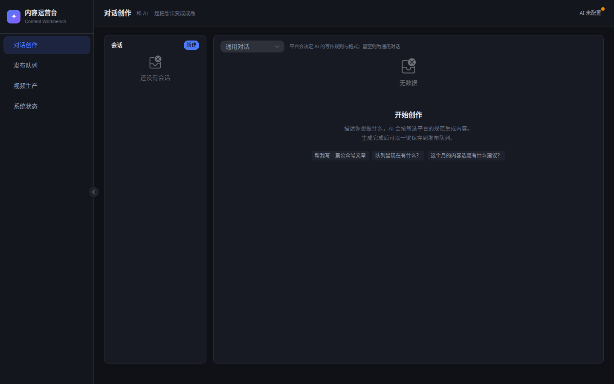

# 内容运营工作台（Content Workbench Pro）

> Vue 3 + TypeScript + Naive UI 前端 · FastAPI + 异步 SQLAlchemy 后端 · 多厂商模型池驱动 · Function Calling 工具链

从 [demo 初稿](../content-workbench/index.html) 演进而来的正式工程化版本：AI 多轮对话创作六平台内容（公众号 / 小红书 / 抖音 / 知乎 / 今日头条 / 百家号）、素材库与知识库、发布队列管理、公众号一键推草稿箱、流量主收益看板、视频生产、多用户 RBAC 权限体系。



**当前版本 v1.10.7** — 完整变更见 [CHANGELOG.md](CHANGELOG.md)，应用内「关于 → 更新日志」同步可查。

## 核心能力

| 能力 | 状态 | 说明 |
|---|---|---|
| AI 多轮对话创作 | ✅ 可用 | SSE 流式输出，会话持久化到数据库，超长自动摘要压缩；DeepSeek / Cloudflare Workers AI / 智谱等多供应商可切换 |
| 六平台文案生成 | ✅ 可用 | 公众号 / 小红书 / 抖音 / 知乎（回答·文章·想法）/ 今日头条 / 百家号，各有独立系统提示词与合规检查 |
| Function Calling | ✅ 可用 | 8 个内置工具（存稿 / 推草稿 / 删草稿 / 渲染视频 / 知乎直达 / 技能激活等），危险操作（推送/渲染）必须人工确认 |
| 公众号推草稿箱 | ✅ 可用 | 官方 `draft/add` + `draft/update`（重复推送原地替换），支持删草稿，需配 IP 白名单 |
| 发布队列 | ✅ 可用 | 状态流转（含「已放弃」）+ 分平台发布检查清单 + 搜索筛选 + Markdown 导出 |
| 素材库 | ✅ 可用 | 多层目录树、批量上传 / zip 打包下载、网格·平铺·树形三视图、在线搜图（Pixabay / Openverse）、哈希去重、火山 TOS 云存储直出 |
| 知识库 | ✅ 可用 | 私有素材/文档入库，写稿自动召回，成稿去重 |
| 技能系统 | ✅ 可用 | SKILL.md 渐进式披露，支持 zip 包 / URL 导入，对话内可开关、痕迹可读 |
| 多厂商模型池 | ✅ 可用 | 服务商/模型/功能绑定、免费额度护栏、自动降级、用量计价与回溯 |
| 收益看板 | ✅ 可用 | 流量主广告数据接入，结算进度四阶段口径，数据导出 |
| AI 痕迹检测 | ✅ 可用 | 腾讯朱雀检测 + 「加人工痕迹」改写，官方同款检测报告单 |
| 视频生产 | ⚙️ 部分 | 小云雀（Pippit）智能生视频已接入（AI 生成标识强制开启）；口播转视频异步渲染为骨架，待接 ffmpeg/edge-tts |
| 多用户 RBAC | ✅ 可用 | JWT 认证、角色权限、按钮级权限、使用配额、邀请码管理 |
| 灵感选题 | ✅ 可用 | 知乎热榜 + 微博热搜灵感卡，「以此选题」一键转成提问 |

## 快速开始

### 1. 后端（uv）

```bash
cd backend
uv venv --python 3.11
uv pip install -r requirements.txt          # 国内加速见下方"国内源"

cp .env.example .env
# 编辑 .env，至少填 DEEPSEEK_API_KEY
# 可选：TOS_* 对象存储配置（素材/配图直出云端，见 docs/火山TOS对象存储接入.md）

.venv/bin/python -m uvicorn app.main:app --reload --port 8000
# 接口文档：http://localhost:8000/docs
```

没用 uv 的话，`python -m venv .venv && source .venv/bin/activate && pip install -r requirements.txt` 等价可用。

没配 API Key 也能启动，AI 对话会返回 error 事件，其余功能（队列/素材库/健康检查）正常。

### 2. 前端

```bash
cd frontend
pnpm install
pnpm dev
# 打开 http://localhost:5173，Vite 已把 /api 代理到 8000 端口
```

### 国内源（强烈建议）

`uv pip install` 默认走 PyPI，国内会很慢。配一次永久生效：

```bash
mkdir -p ~/.config/uv
cat > ~/.config/uv/uv.toml <<'EOF'
[[index]]
url = "https://pypi.tuna.tsinghua.edu.cn/simple"
default = true
EOF
```

也可以临时指定：`uv pip install --index-url https://pypi.tuna.tsinghua.edu.cn/simple -r requirements.txt`

npm 换源：`npm config set registry https://mirrors.tencent.com/npm/`

实测：全部后端依赖在清华源下 **约 5 秒**装完。

### 3. 上服务器

不走容器，用 **uv + systemd + nginx**，完整步骤见 [deploy/README.md](deploy/README.md)。
生产环境建议配置火山 TOS 对象存储（`STORAGE_BACKEND=s3`），图片直出云端不占服务器带宽。

## 目录结构

```
content-workbench-pro/
├── backend/
│   ├── app/
│   │   ├── core/            # 配置、缓存（Redis/内存双实现）、RBAC、日志
│   │   ├── db/              # 异步 SQLAlchemy 会话 + 轻量列补丁迁移
│   │   ├── models/          # User/Conversation/Content/QueueItem/Asset(+/Folder)/
│   │   │                    # Knowledge/Skill/ModelPool/Revenue/Usage/Invite 等
│   │   ├── schemas/         # Pydantic 请求/响应模型
│   │   ├── routers/         # auth/chat/queue/assets/knowledge/skills/revenue/
│   │   │                    # model_pool/usage/zhihu/weibo/humanize/layout 等 20 个
│   │   ├── services/        # llm(模型路由)/agent(编排)/wechat/storage(本地+TOS)/render
│   │   ├── prompts/         # 六平台系统提示词
│   │   └── tools/           # 工具注册中心 + 8 个内置工具
│   └── requirements.txt
├── frontend/
│   └── src/
│       ├── api/             # axios 封装 + SSE 手动解析
│       ├── stores/          # Pinia：chat / queue / auth / version
│       ├── views/           # Chat/Queue/Assets/Knowledge/Skills/Revenue/
│       │                    # ModelPool/Usage/Video/Settings/Profile/Admin 等 14 页
│       ├── version/         # 应用内更新日志（与 APP_VERSION 同步）
│       └── types/           # 与后端 schema 一一对应的 TS 类型
├── deploy/                  # nginx 配置、systemd 单元、保活/看门狗脚本、部署手册
├── docs/                    # 架构、API、开发指南、调研与方案、截图
└── CHANGELOG.md             # 版本更新日志
```

## 技术决策速记

详细论证见 [docs/架构设计.md](docs/架构设计.md)，要点：

- **不上 LangChain 等重型 Agent 框架**。内容创作是确定性工作流，手写编排（`services/agent.py`，最多 5 轮工具循环）+ 原生 Function Calling 足够，少一层抽象少一类 bug。
- **前端 Vue 3 + TS + Naive UI**（团队指定的选型）。SSE 用 `fetch + ReadableStream` 手动解析——`EventSource` 只支持 GET，而对话是 POST。
- **缓存双实现**：`REDIS_URL` 留空自动降级内存缓存，本地开发零依赖，生产多进程部署建议配 Redis。
- **存储双后端**：`STORAGE_BACKEND=local|s3`，同一套 `StorageBackend` 抽象（put/get/delete/url）。本地用 HMAC 签名短直链，TOS 用公开读永久链接——换后端不迁移数据、不改业务代码。详见 [docs/火山TOS对象存储接入.md](docs/火山TOS对象存储接入.md)。
- **部署不用容器**：uv 管依赖、systemd 守护进程、nginx 托管前端。依赖装得飞快，排查问题所见即所得。
- **危险工具必须人工确认**。推送草稿箱、提交渲染带 `requires_confirm` 标记，模型只产生调用意图，执行权在用户手里——这既是《微信公众平台运营规范》的合规要求，也是账号安全底线。
- **AI 生成标识强制开启**（小云雀生视频）。《人工智能生成合成内容标识办法》的法定要求，没有关掉的开关。

## 关键合规边界

> ⚠️ 《微信公众平台运营规范》禁止「利用 AI、脚本、接口或其他自动化方式替代真人完成内容创作、发布」。

本工作台的定位是**辅助创作**：AI 生成 → 人工审核修改 → 人工触发推送草稿箱 → 人工在公众号后台群发。`freepublish` 自动群发接口对个人订阅号已回收，也不要尝试模拟浏览器自动群发——已有封号案例。

## 版本与更新日志

- 仓库级变更记录：[CHANGELOG.md](CHANGELOG.md)
- 应用内更新日志（弹窗/列表）：`frontend/src/version/changelog.ts`
- 版本号单一来源：`backend/app/core/config.py` 的 `APP_VERSION`，升版本时三处同步

## 文档索引

- [架构设计](docs/架构设计.md) — 分层结构、Agent 编排、上下文管理、成本优化
- [API 接口文档](docs/API接口文档.md) — 全部路由 + SSE 事件协议
- [开发指南](docs/开发指南.md) — 加新工具/新平台/新视图的步骤、常见坑
- [部署手册](deploy/README.md) — uv 装依赖、systemd 守护、nginx 反代、切 Postgres、IP 白名单
- [火山 TOS 对象存储接入](docs/火山TOS对象存储接入.md) — 为什么接、怎么配、踩过的坑
- [素材库模块调研与实现方案](docs/素材库模块调研与实现方案.md) — 素材库设计与在线图源合规
- [更新日志](CHANGELOG.md) — 全部版本变更
